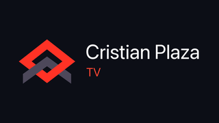
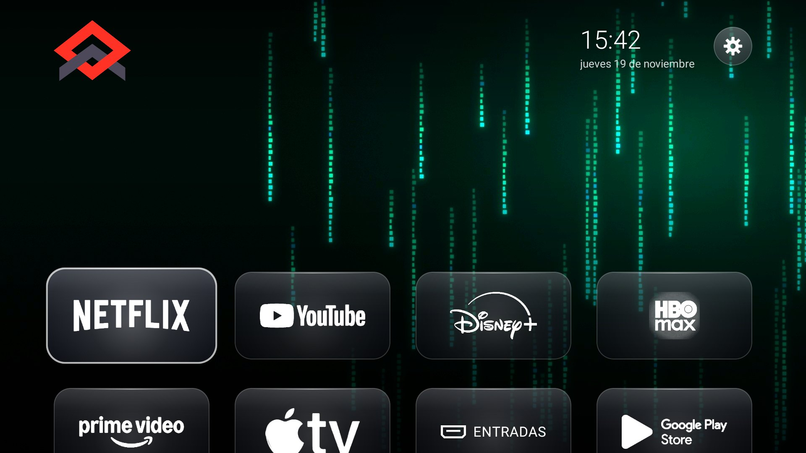
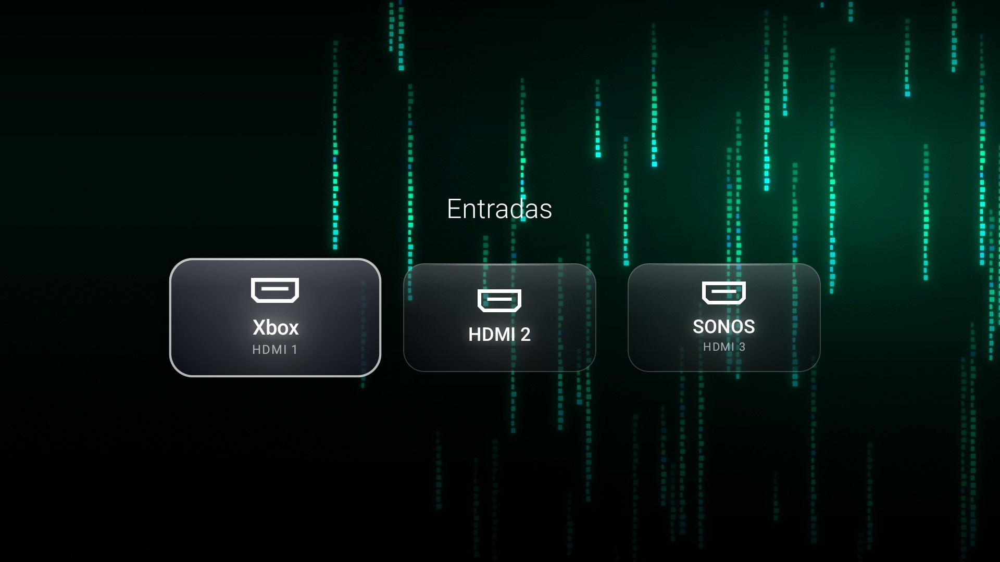
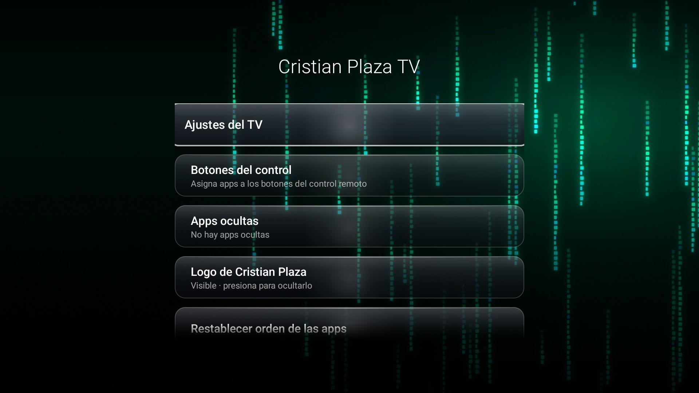
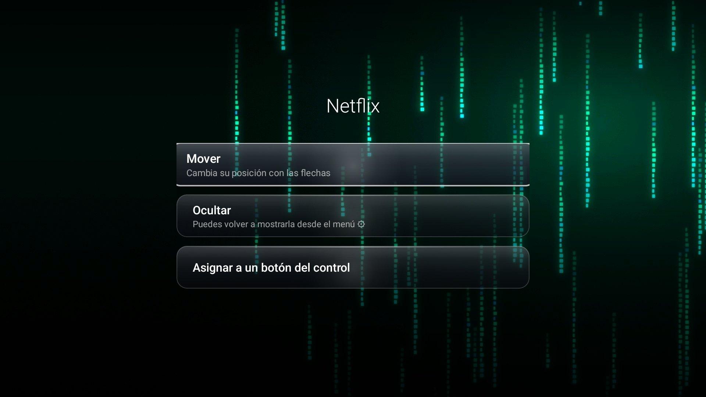

<div align="center">



# Cristian Plaza TV

**Un launcher minimalista para Android TV y Google TV, con estilo de vidrio oscuro, sin anuncios y sin recomendaciones.**

[](../../releases/latest)
[](#requisitos)
[](LICENSE)

### [⬇️ Descargar la última versión](../../releases/latest)

<!-- VIDEO: reemplazar VIDEO_ID cuando el video esté publicado -->
<!-- [](https://www.youtube.com/watch?v=VIDEO_ID) -->
🎬 **Video tutorial:** próximamente en YouTube.

</div>

---

<div align="center">



<table>
<tr>
<td></td>
<td></td>
<td></td>
</tr>
<tr>
<td align="center"><sub>Entradas HDMI detectadas solas</sub></td>
<td align="center"><sub>Menú ⚙</sub></td>
<td align="center"><sub>Mantener presionado OK</sub></td>
</tr>
</table>

<sub>Capturas reales en una TCL con Google TV.</sub>

</div>

## ✨ Qué hace

| | |
|---|---|
| 🪟 **Estilo vidrio** | Tarjetas oscuras translúcidas con reflejo, borde de luz y brillo al seleccionarlas. |
| ⚪ **Logos en blanco** | Cada app se muestra con su logo en blanco. Se genera en tu propio TV a partir de las apps que tienes instaladas, así que funciona con cualquier app. |
| 🌌 **Fondos que cambian** | 18 fondos tecnológicos originales que rotan cada 5 minutos con un fundido suave. Puedes agregar los tuyos. |
| 🔌 **Entradas HDMI** | Un menú con tus HDMI, que muestra el nombre del equipo conectado cuando el TV lo conoce. |
| ✋ **Organiza a tu gusto** | Mantén presionado **OK** sobre una app para moverla, ocultarla, desinstalarla o asignarla a un botón. |
| 🎮 **Botones del control** | Haz que el botón de una app que no usas abra otra. Por ejemplo, el botón de Prime Video puede abrir Max. |
| 🪶 **Liviano** | Sin anuncios, sin rastreo, sin internet y sin procesos en segundo plano. |

## 📋 Requisitos

- TV o dispositivo con **Android TV / Google TV**, Android 9 o superior.
- Un **computador** (Windows, Mac o Linux) en la **misma red Wi-Fi**, para la instalación completa.
- [SDK Platform-Tools](https://developer.android.com/tools/releases/platform-tools) de Google (`adb`).

## 🚀 Instalación

1. Descarga el **`.zip`** desde [Releases](../../releases/latest) y descomprímelo.
2. **En el TV:** activa las *Opciones de desarrollador*. Ve a *Ajustes → Sistema → Información* y presiona **7 veces** *Compilación*. Después activa **Depuración USB** y **Depuración por red**.
3. Anota la **IP del TV**. Está en *Ajustes → Red e Internet → tu Wi-Fi*.
4. Ejecuta el instalador:
   - **Windows** *(beta, aún sin probar)*: doble clic en `instalar.bat`
   - **Mac / Linux:** `./instalar.sh 192.168.1.50` (con la IP de tu TV)
5. En el TV, acepta **"¿Permitir depuración?"**, marcando *Permitir siempre*.

El instalador pregunta si quieres usarlo como **pantalla de inicio**. Si respondes que sí, desactiva el inicio de Google TV. Ajustes, Chromecast, el asistente de voz y todas tus apps siguen funcionando.

> 💡 **¿Sin computador?** Instala el `.apk` con la app *Downloader* o un pendrive y ábrelo desde la lista de apps. Funciona igual, pero el botón Inicio seguirá abriendo Google TV.

La guía completa está en [`scripts/LEEME.md`](scripts/LEEME.md).

### 🧹 Opcional: limpiar un TV Xiaomi

`limpiar-xiaomi` quita el rastreo y la publicidad preinstalados de Xiaomi y Google, y libera espacio. Antes de quitar nada te muestra la lista y te pide confirmación, y es reversible.

### 🤖 Opcional: que una IA lo haga por ti (Claude Code o Codex)

La skill [`preparar-tv`](skill/) hace todo el proceso con tu agente de IA:

- limpieza básica (rastreo y publicidad) o **profunda** (apps basura del fabricante y de Google), siempre con confirmación y reversible;
- instalación del launcher como inicio;
- verificación después de reiniciar.

Funciona en Xiaomi y TCL, y con cautela en otras marcas. Las instrucciones están en [`skill/README.md`](skill/README.md).

### ↩️ Deshacer

`deshacer.bat` / `./deshacer.sh <IP>` deja el TV como estaba:

- reactiva el inicio de Google TV,
- restaura las apps que quitó la limpieza,
- desinstala Cristian Plaza TV.

## 🎛️ Uso

| Acción | Cómo |
|---|---|
| Abrir una app | Selecciónala y presiona **OK** |
| Mover / ocultar / desinstalar / asignar a un botón | **Mantén presionado OK** sobre la app |
| Menú (Ajustes del TV, botones del control, apps ocultas, nombre del menú, logo) | Botón **⚙** arriba a la derecha, o la tecla **Menú** del control |
| Cambiar de entrada HDMI | Tarjeta **Entradas**, o el botón **Entradas** del control |
| Agregar fondos propios | Copia imágenes a `Android/data/com.cristianplaza.tv/files/fondos` |

## ❓ Preguntas frecuentes

<details>
<summary><b>¿Es seguro?</b></summary>

No requiere root ni desbloquear nada. Todo lo que hacen los scripts se puede deshacer con `deshacer`. El código es abierto, así que puedes revisarlo. El servicio de botones del control solo captura los botones que tú asignas y no lee nada de la pantalla.
</details>

<details>
<summary><b>Una app aparece con su nombre en vez del logo</b></summary>

Algunas apps no traen un banner que se pueda convertir a blanco. En ese caso se muestra su nombre, con el mismo estilo.
</details>

<details>
<summary><b>Los botones del control dejaron de funcionar</b></summary>

Presiona **Inicio** una vez, porque el launcher reactiva el servicio solo. Si no funciona, actívalo en *Ajustes → Accesibilidad → Botones del control*.
</details>

<details>
<summary><b>¿Funciona en mi TV (Sony, TCL, Hisense, Chromecast…)?</b></summary>

Debería funcionar en cualquier Android TV / Google TV con Android 9 o superior. La limpieza opcional es solo para Xiaomi, y los botones especiales del control varían según la marca: se configuran desde el menú ⚙.
</details>

## 🛠️ Compilar desde el código

No necesita Android Studio ni Gradle, solo el JDK 17 y el SDK de Android (`platforms;android-34`, `build-tools;34.0.0`):

```bash
./build.sh
```

El APK firmado queda en `dist/`. La primera vez se genera una firma nueva en `firma/`, que no se sube al repo.

```
src/com/cristianplaza/tv/
├── MainActivity.java    # launcher: cuadrícula, vidrio, fondos, menús, entradas
├── LogoBlanco.java      # convierte el banner de cada app en logo blanco (en el TV)
└── BotonesControl.java  # servicio opcional para reasignar botones del control
```

## 📄 Licencia

[MIT](LICENSE) © Cristian Plaza

Las marcas y logos de las apps pertenecen a sus dueños. El APK **no incluye** ningún logo de terceros: cada TV los genera a partir de las apps que tiene instaladas.
